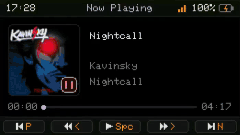

# Cardputer Now Playing

An Apple Music display and playback controller for the M5Stack Cardputer-Adv. A macOS companion sends **track metadata and album art** to the device, and the physical keyboard sends playback commands back.



## A Bridge to Apple Music

The Python companion reads Apple Music through AppleScript. It also uses macOS’s built-in image tools to prepare artwork for the device.

The physical Cardputer uses BLE, while the project also supports a Wi-Fi/WebSocket path for its browser dashboard and Wokwi simulator. The optional BLE connection on the Mac uses Bleak; the Wi-Fi bridge path can run with the Python standard library.

```text
Apple Music ↔ macOS Python bridge ↔ BLE / Wi-Fi ↔ Cardputer
```

The bridge supplies metadata and artwork, while the device remains responsible for drawing the interface and interpreting its keyboard input.

## Rendering on a Small Display

Artwork is converted to **72×72 RGB565 data** rather than sending a full desktop-sized image. The firmware caches it on microSD, or LittleFS when no card is available, so replaying an album doesn’t require fetching the same artwork again.

The layout reserves two lines for the song title and fixed positions for artist and album. Keeping those regions stable avoids moving the rest of the interface when the title changes length.

Updates target changed content rather than continuously redrawing the entire display. Playback state, track metadata, artwork, and progress can change at different rates.

## Device Controls

Space toggles play/pause. The four printed arrow keys provide track navigation and ten-second seeking. Holding G0 opens setup, with Wi-Fi credentials stored in NVS for the networked mode.

There are separate PlatformIO targets for physical Cardputer-Adv hardware and the ESP32-S3 Wokwi setup. The simulator is useful for layout and bridge behavior, but it does not establish the reliability of the physical keyboard, radio link, or storage hardware.

The companion requires a Mac running Apple Music. This is a remote display and controller; it doesn’t stream or decode the audio on the Cardputer.
