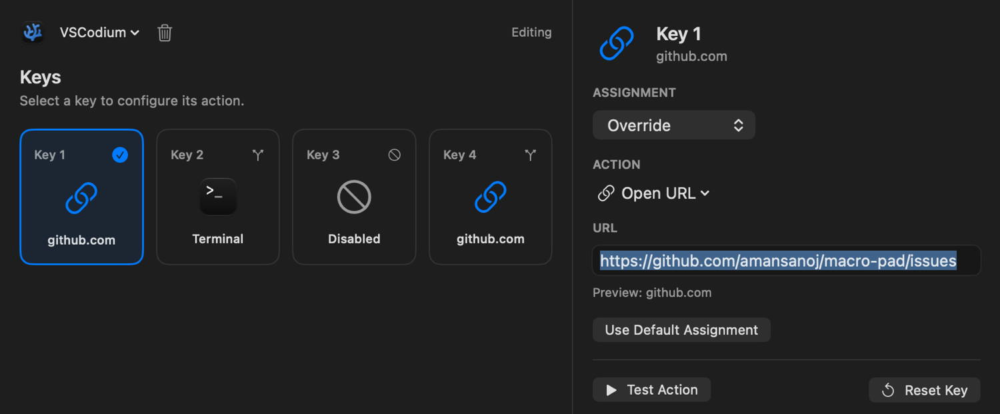

# Macro Pad

A four-switch Bluetooth controller and a native macOS app. The ESP32 reports button transitions; the Mac decides what each button does, including assignments that change with the active application.

## Keeping Assignments on the Mac

The firmware handles GPIO input, debounce, and BLE notifications. It doesn’t store application paths or execute commands. Each packet identifies a key, its transition state, a protocol version, and a sequence number.

That separation means changing an assignment doesn’t require flashing the board. The companion uses CoreBluetooth to receive events and dispatches actions through the Mac’s APIs.

```text
Switch → GPIO debounce → BLE notification
       → CoreBluetooth → profile lookup → action dispatcher
```

The app can launch applications, send keyboard shortcuts, open HTTP(S) URLs, run Apple Shortcuts, or start a configured process. Profiles match applications by bundle identifier, so the same physical switch can have different assignments in different apps.

## Handling Repeated and Reconnected Input

Only a new key-down executes an assignment. Key-up updates the displayed state, and duplicate or held-key events are suppressed.

After connecting, the firmware sends non-executing synchronization packets for all four keys. A button held during reconnection can appear pressed without unexpectedly launching its action.

Discovery filters by the BLE service UUID, and the app remembers the selected peripheral identifier. Reconnection uses bounded backoff rather than continuously retrying at full speed.

## The macOS Interface

The app lives in the menu bar, with a small status popover and a separate configuration window. Assignments are stored locally in versioned JSON using atomic writes. Simulation mode exercises the same event dispatcher without requiring the board to be connected.



Keyboard shortcut actions require Accessibility permission. The recorder uses a temporary event tap while recording; system-reserved combinations are still subject to macOS restrictions.

## Hardware and Validation

The controller uses an ESP32-WROOM-32 and four switches connected to GPIO 13, 14, 33, and 32 with a shared ground. Internal pull-ups keep the wiring simple; no keyboard matrix is needed.

Automated checks cover protocol validation, duplicate suppression, profile resolution, configuration migration, and action failures. BLE connectivity, reconnection, button input, and end-to-end macro execution have also been tested manually on physical hardware.

The release app is ad-hoc signed rather than Developer ID signed and notarized. Profiles distinguish applications, not individual windows or browser tabs. First-pairing BLE Just Works also does not provide protection against an active device impersonator.
